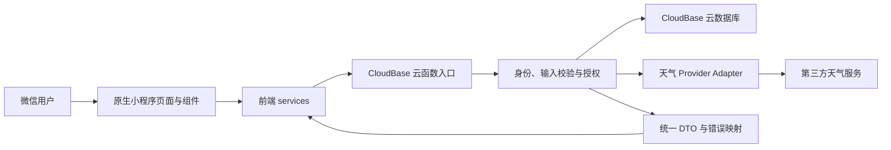
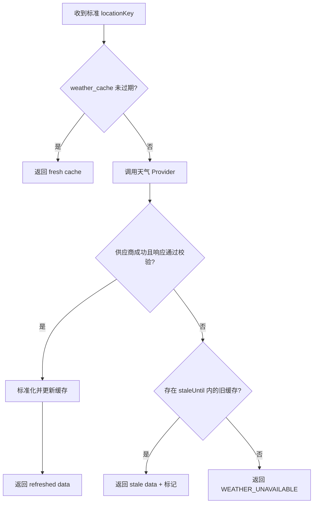

# 轻记总体技术架构

> 状态：MVP 技术设计基线  
> 依据：[`requirements.md`](./requirements.md) 与仓库根目录 [`AGENTS.md`](../AGENTS.md)  
> 本文只定义技术边界，不代表相关代码、云资源或第三方服务已经创建。

## 1. 目标、范围与设计决策

轻记采用微信原生小程序与 CloudBase，形成“前端只编排、云函数做可信业务、数据库默认拒绝客户端直连”的结构。MVP 覆盖：

- 微信用户初始化和基础设置；
- 收入/支出账单、分类、账户维度、本月汇总与基础月预算；
- 待办新增、修改、完成/撤销、删除和列表；
- 实时天气、未来三日预报、手动城市选择；
- 首页天气、待办、收支聚合；
- 数据隔离、错误处理、基础隐私与个人数据删除入口。

以下需求不进入当前技术实现：资金渠道自定义管理、资产核算、重复任务、订阅消息、日历视图、小时预报、户外任务联动、分类预算、附件、数据导出、回收站、OCR、AI、家庭账本和协作。固定的微信、支付宝、银行卡、现金和其他仅作为账单的支付/收款方式。

### 1.1 规范命名

需求稿中的部分字段属于早期草案，本文及配套文档采用以下规范名：

| 含义 | 规范名 | 说明 |
| --- | --- | --- |
| 数据所属用户 | `ownerId` | 指向 `users._id`，永不接受客户端赋值 |
| 金额（分） | `amountInCents` | 正整数；预算为 `budgetAmountInCents` |
| 月份 | `monthKey` | `YYYY-MM`，按设置时区解释 |
| 自然日 | `dateKey` / `occurredDateKey` / `dueDateKey` | `YYYY-MM-DD`，按设置时区解释 |
| 服务端响应时间 | `serverTime` | 带 `Z` 或偏移量的 ISO 8601 字符串 |
| 并发版本 | `version` | 从 1 开始的整数，更新时递增 |

`users` 仅保存身份和账号状态；默认记账类型、默认支付/收款方式、默认城市、定位偏好和时区只保存在 `user_settings`，避免双数据源。

## 2. 系统上下文与请求链路



强制链路：

1. 页面或业务组件调用对应的前端 service；
2. service 使用 `wx.cloud.callFunction` 调用云函数并映射 DTO；
3. 云函数从可信微信上下文取得 `OPENID`，解析内部用户；
4. 云函数校验输入和资源归属后访问数据库或天气服务；
5. 云函数返回稳定响应封装，service 转换为页面模型；
6. 页面只负责状态和交互反馈。

小程序端任何目录都不得使用 `wx.cloud.database()` 访问业务集合，也不得直接请求天气供应商。

## 3. 小程序前端分层

建议目录与依赖方向：

```text
miniprogram/
├─ pages/          # 路由、生命周期、页面状态和用例编排
├─ components/     # 可复用展示与局部交互
├─ services/       # 云函数调用、超时、错误与 DTO 映射
├─ models/         # 页面模型与领域类型
├─ utils/          # 金额、日期等无状态纯函数
├─ constants/      # action 名、错误码、稳定枚举
└─ types/          # 微信平台与外部类型补充
```

### 3.1 页面层

- 接收路由参数、处理生命周期和刷新时机；
- 组合多个 service 用例，并维护 `loading | empty | success | error` 状态；
- 防止重复提交，展示可重试或局部降级反馈；
- 不实现权限、金额换算、数据聚合或供应商响应解析。

### 3.2 组件层

- 通过 properties 接收稳定展示模型，通过 events 上报用户意图；
- 默认不调用 service；仅在确有独立业务生命周期且有测试时允许业务组件调用 service；
- 不持有跨页面全局业务状态，不直接访问数据库或外部网络。

### 3.3 Service 层

- 按域提供 `userService`、`ledgerService`、`statisticsService`、`todoService`、`weatherService`、`homeService`；统计 service 仍调用现有 `ledger` 云函数的只读 action；
- 统一封装云函数名称、action、请求 ID、超时、响应解包和错误映射；
- 将 API DTO 转为前端模型，不泄漏 CloudBase 或天气供应商结构；
- 不弹 toast、不改页面数据、不读写 WXML；
- 写请求只在确认幂等时自动重试；创建账单和待办必须携带同一个 `requestId` 重试。

### 3.4 Model、Utils 与本地缓存

- `models/` 区分 API DTO、领域模型、页面展示模型；
- 金额输入先作为字符串，由共享纯函数解析为整数分；
- 时间格式化统一经过工具层，页面不得自行截断 UTC 日期；
- 本地缓存只用于加速最近一次首页与天气展示，必须记录缓存时间；
- MVP 不做自动离线同步。离线新增仅可作为未提交草稿，恢复网络后由用户确认提交。

MVP 不默认引入全局状态库。跨页数据优先重新查询或通过轻量应用状态保存；确有复杂共享状态后再单独评估依赖。

## 4. 云函数分层

云函数按业务域拆分为 `user`、`ledger`、`todo`、`weather` 和 `home`。每个函数可使用 `action` 分派相关用例，但不得成为跨域通用大函数。

```text
cloudfunctions/<domain>/
├─ index.ts          # 唯一入口：解析 action、建立 request context
├─ application/      # 用例编排、事务边界、DTO
├─ domain/           # 领域规则、纯校验和计算
├─ infrastructure/   # CloudBase repository、天气 provider、日志
└─ shared/           # 仅该云函数内部共享；跨函数契约来自仓库 shared/
```

每次请求依次经过：

1. **入口层**：生成或接收 `requestId`，建立结构化日志上下文；
2. **身份层**：取得可信 `OPENID`，解析有效 `users` 记录；
3. **校验层**：对 action 和 payload 做运行时校验，拒绝未知字段和超限值；
4. **应用层**：执行业务用例和并发/幂等控制；
5. **仓储或 Provider 层**：访问数据库、缓存或天气服务；
6. **响应层**：映射稳定 DTO，隐藏堆栈、数据库字段和供应商错误。

云函数之间默认不相互调用；共享纯代码可由构建流程复制/打包。`home` 聚合函数可以复用同域 repository 逻辑或并行读取数据库，但不能通过小程序端串行拼装多个敏感查询。

## 5. 用户身份与数据授权

### 5.1 身份建立

- 微信小程序调用的普通云函数使用 `wx-server-sdk` 的 `cloud.getWXContext()` 获取 `OPENID`；`OPENID` 来自可信调用链，不从 `event` 读取。
- `user.init` 按 `openId` 查找 `users`。不存在时创建 `users`，并幂等补齐 `user_settings`、固定支付/收款渠道和默认分类；默认待办清单留给待办域任务。
- 其他接口必须解析到 `status = active` 的内部用户，得到 `users._id` 作为当前 `ownerId`。
- `UNIONID` 不是 MVP 身份主键，也不自建 JWT。若未来扩展到非微信客户端，需另行设计认证迁移。

CloudBase 官方说明 `getWXContext()` 的身份字段来自平台调用链，不能由业务请求字段伪造；小程序调用云函数与自定义 Web 登录链路不可混用：[在微信小程序中调用 CloudBase 云函数](https://docs.cloudbase.net/recipes/add-cloud-function-wechat-miniprogram)。

### 5.2 授权检查

- 客户端请求不得出现可写的 `ownerId`、`openId`、`userId`；出现时直接按非法参数拒绝，而不是覆盖后继续执行。
- 所有用户业务集合查询都包含 `{ ownerId: currentUserId }`；详情、修改和删除同时包含资源 `_id`。
- 更新/删除必须检查影响记录数；不存在和非本人资源统一返回 `RESOURCE_NOT_FOUND`，避免资源枚举。
- 引用 `categoryId`、`accountId`、`listId` 时，云函数还需验证被引用资源属于同一 `ownerId` 且可用。
- 数据库安全规则将小程序客户端对业务集合的读写设为拒绝；仅云函数服务身份可访问。规则是第二道防线，不能替代应用层归属校验。
- 日志只保存 request ID、action、耗时、错误码和脱敏用户标识，不记录 `OPENID` 全值、精确位置、账目备注或密钥。

## 6. 天气代理与缓存

### 6.1 调用边界

- MVP 天气供应商 adapter 采用 Open-Meteo 免费开放接口。Forecast 与 Geocoding host 固定在 adapter 内，不需要 API Key，客户端不能改变 host、path 或查询字段。
- 免费开放接口仅用于个人非商业场景，受每分钟、每小时和每日调用上限约束且无可用性承诺；现有服务端缓存与用户限流共同控制请求量。
- 天气页面和首页展示 `Open-Meteo` 数据来源署名；商业发布前必须重新确认许可，或切换其商业端点/自托管服务。

### 6.2 位置输入

- 优先使用 `user_settings.defaultLocation.locationKey`；也允许用户主动提交城市搜索结果中的 `locationKey`。
- Open-Meteo 位置标识统一包装为 `open-meteo:<latitude>,<longitude>`；经纬度最多保留四位小数，供应商字段仅存在 adapter 内，不向页面扩散。
- 经纬度只能在用户主动授权后临时传给 `weather.searchLocations`；服务端校验范围并四舍五入到小数点后 2 位，不保存轨迹。
- 前端不得直接提交供应商 URL、任意 host 或任意查询参数，防止代理被滥用。

### 6.3 缓存流程



规范 TTL：

| 数据类型 | 新鲜缓存 TTL | 失败时最大陈旧窗口 |
| --- | ---: | ---: |
| `current` | 15 分钟 | 6 小时 |
| `daily`（未来三日） | 2 小时 | 24 小时 |
| 城市搜索结果（可选） | 24 小时 | 不返回过期结果 |

响应必须包含 `observedAt`、`fetchedAt`、`cacheStatus`（`fresh | refreshed | stale`）和 `provider`。当使用陈旧数据时，页面必须显示更新时间，不得伪装实时。

`weather_cache` 是服务端共享的非用户业务缓存；缓存键由 `provider + locationKey + dataType` 组成。设置最大输入长度、单用户调用频率和云函数超时。并发缓存未命中允许极少量重复拉取，若供应商限额成为瓶颈，再增加短租约锁，不在 MVP 预先引入额外基础设施。

## 7. 金额处理

- CNY 是 MVP 唯一币种；所有存储、API 和计算金额均为以分为单位的 JavaScript 安全整数。
- 账单金额字段固定为 `amountInCents`，必须大于 0；收入/支出方向由 `type: income | expense` 表示，不能使用金额正负表示。
- 前端接收 `"12.34"` 这类字符串，用字符串分段算法转换为 `1234`，禁止使用 `parseFloat(value) * 100` 直接入库。
- 服务端再次检查 `Number.isSafeInteger`、正数和产品上限；单笔上限尚未确认，配置前接口必须使用一个经产品确认的常量。
- 预算使用 `budgetAmountInCents`；收入、支出、结余和预算汇总仅做整数加减。

## 8. 时间处理

- 数据库中的具体时刻使用 CloudBase `Date`，由服务端生成 `createdAt`、`updatedAt`、`completedAt`、`deletedAt`；业务发生时间 `occurredAt` 可由客户端提供，但必须是合法 ISO 8601 时刻并受合理范围限制。
- API 请求和响应中的具体时刻统一为带 `Z` 或 UTC 偏移的 ISO 8601 字符串，不传 `Date` 实例，不混用秒/毫秒时间戳。
- 用户时区唯一来源是 `user_settings.timezone`，MVP 默认 `Asia/Shanghai`。
- 账单写入时由服务端按用户时区派生 `occurredDateKey: YYYY-MM-DD`；月查询按时区计算半开区间 `[startAt, endAt)`，`monthKey` 为 `YYYY-MM`。
- 待办区分 `dueKind: none | date | datetime`：
  - `none`：`dueDateKey = null`、`dueAt = null`；
  - `date`：只保存 `dueDateKey`，不伪造午夜 `dueAt`；
  - `datetime`：保存 `dueAt`，并派生 `dueDateKey`。
- “今日”和“逾期”都由服务端按用户时区计算，不能用设备 UTC 截断结果；无截止时间待办永不自动判为逾期。

## 9. 一致性、幂等与并发

- 用户初始化为用户、设置、系统分类和系统账户生成确定性文档 ID，并在单个服务端事务内通过 `doc` 读写；这符合 CloudBase 事务仅支持单文档操作的限制。
- `users.openId`、`user_settings.ownerId`、分类稳定键和账户稳定键仍需唯一索引作为数据完整性第二道防线；索引未建立前确定性 `_id` 仍可阻止同一模板的并发重复，但上线前不得省略索引配置。
- 重复初始化只补齐缺失稳定键，不更新现有默认项的名称、图标、排序或启用状态；`initializationVersion` 用于区分未完成初始化与用户主动清空的设置。
- 创建账单、创建待办必须传 UUID 格式 `requestId`；集合对 `{ ownerId, requestId }` 建唯一索引，重复请求返回首次创建的资源。
- 当前收入和支出创建均使用 `ownerId + requestId` 派生确定性 `transactions._id`，并在 CloudBase 事务内先读取该文档再创建；快速并发请求竞争同一文档，重试时会核对首次记录与规范化请求内容，相同内容返回首次记录，不同内容拒绝复用 requestId。确定性 ID 不替代唯一索引，后者仍防止未来其他入口按相同业务键写出重复数据。
- 当前收支流水默认在一次查询中使用 `ownerId + isDeleted=false + type in [expense, income]` 和用户时区月份半开区间，可选 `all | expense | income` 最小筛选，按 `occurredAt DESC, _id DESC` 做全局复合游标分页；游标绑定筛选和年月并严格解析，但不承担授权，服务端每页都重新附加可信用户条件。这样收入和支出不会因双查询合并而跨页重复或遗漏。全月收入和支出分别由云端聚合计算，结余使用整数分相减，不从前端已加载页推算。
- 统计页通过 `getStatisticsSummary`、`getStatisticsTrend` 和 `getCategoryStatistics` 三个只读 action 并行加载。服务端按用户时区计算月份边界并在数据库侧聚合；趋势固定支持 6/12 个月、补齐空月并按旧到新返回。分类统计聚合后批量关联当前分类名称，缺失分类以“已删除分类”保留金额。前端允许模块级失败，不因一个分类请求失败清空其他已成功数据。
- 独立 `ledger.getMonthlySummary` 继续供单模块页面复用。首页现由 `home.getOverview` 在可信身份和用户时区下并行聚合当日/月收支、今日/逾期待办与天气；三个模块各自返回 `success/unavailable`，任一失败不清空其他成功数据。
- 更新和删除传 `expectedVersion`，事务读取后同时校验 `ownerId`、`_id`、`version`、`isDeleted: false`；成功后 `version + 1`。通用资源版本不匹配返回 `VERSION_CONFLICT`，账单使用更具体的 `TRANSACTION_CONFLICT`。
- 当前收入和支出新增、编辑、删除只写入交易事实；`accounts` 仅在创建/编辑时用于校验资金渠道的归属、存在性和启用状态，不因交易发生而变更。记录保存最近一次变更 requestId、操作类型和服务端请求指纹，使成功响应丢失后的同请求重试返回等效结果，同 requestId 改变 payload 则拒绝。
- 逻辑删除统一设置 `isDeleted = true`、`deletedAt` 和新版本；所有正常查询显式过滤 `isDeleted: false`。

### 6.6 设置与个人数据删除

- `user_settings` 是唯一偏好集合；`updateSettings` 使用 `group = ledger | weather` 的判别联合，整文档写回前只应用当前分组字段，避免天气更新覆盖记账默认值。
- 两个默认固定渠道均在云函数事务内校验当前 `ownerId`、存在性和启用状态；`updatedAt` 由服务端生成。
- 小程序只调用 `dataDeletion.getStatus/request/cancel`。申请使用顶层 `requestId` 幂等，冷静期固定 7 天，`pending` 可撤销。
- `dataDeletionExecutor` 是独立云函数，不进入前端常量；它验证云端令牌，按执行租约认领到期申请，逐集合、逐批按 `ownerId` 删除，最后删除用户文档并将申请标记完成。
- 失败批次保存受控错误码、进度和下一重试时间；重复执行和已删除文档均安全。共享天气缓存不包含用户身份，不随个人删除清理。
- 基础预算按 `{ ownerId, monthKey }` 唯一，并采用 upsert 语义；花费值从账单聚合，不重复存储为事实字段。
- 首页聚合的多个模块独立返回状态；天气失败不回滚或阻断账目、待办摘要。

CloudBase 文档型数据库支持唯一索引；唯一字段缺失会按 `null` 参与唯一性检查，因此所有幂等索引字段必须在目标记录中必填：[索引管理](https://docs.cloudbase.net/database/data-index)。

## 10. 错误、日志与可观测性

统一响应：

```ts
type ApiResponse<T> =
  | { success: true; code: "OK"; message: string; data: T; requestId: string; serverTime: string }
  | { success: false; code: ErrorCode; message: string; data: null; requestId: string; serverTime: string };
```

错误至少区分：`INVALID_ARGUMENT`、`UNAUTHENTICATED`、`USER_DISABLED`、`RESOURCE_NOT_FOUND`、`VERSION_CONFLICT`、`RATE_LIMITED`、`WEATHER_UNAVAILABLE`、`DEPENDENCY_ERROR`、`INTERNAL_ERROR`。

- 输入错误和可预期业务错误记录为 info/warn，内部错误记录为 error；
- 对外不返回堆栈、集合名、查询条件、供应商原始响应或密钥；
- 每个云函数记录 action、requestId、结果码和耗时；
- 首页与天气响应暴露数据更新时间，但不暴露服务端调试信息；
- MVP 先使用 CloudBase 日志，是否接入额外监控在出现明确需求后评估。

## 11. 环境、部署与安全边界

- 至少划分开发、测试、生产三个 CloudBase 环境，集合、云函数、存储和天气密钥互相隔离；小程序分别按 `develop`、`trial`、`release` 选择对应环境；
- 环境 ID 通过被忽略的 `.env.local` 或发布机环境变量生成前端运行时配置；生成文件不纳入版本控制，前端不持有 AppSecret 或第三方 Key；
- 环境变量配置文件若纳入版本控制，只能声明变量名或空占位，不得包含真实值；
- 云函数使用当前环境默认凭据访问 CloudBase，不在代码中配置永久 SecretId/SecretKey；
- 业务集合关闭小程序客户端直接读写；天气缓存也仅云函数可读写；
- 生产部署前执行密钥扫描、权限规则检查、跨用户访问测试和数据删除演练。

## 12. 已知待定项

以下项目在编码前仍需确认，不能由实现者静默决定：

1. Open-Meteo 非商业许可是否覆盖最终发布形态；若商业化，需选择商业端点或自托管；
2. CloudBase 测试/生产环境 ID 与最终发布流水线；当前开发环境部署基线采用 `Nodejs16.13`；
3. 微信基础库最低版本与目标机型范围；
4. 是否使用 TDesign、WeUI 或纯原生组件，以及包体积预算；
5. 单笔账单金额上限、备注/标题长度等产品阈值；
6. 删除申请审计记录和云函数日志的生产保留周期；
7. 隐私政策文本、Open-Meteo 第三方处理披露和小程序后台隐私接口配置；
8. MVP 基础预算是否必须首发；若延期，首页预算字段需同时隐藏。

这些待定项不影响当前字段与接口命名基线；影响实现行为的值应在开发任务开始前形成简短决策记录。
