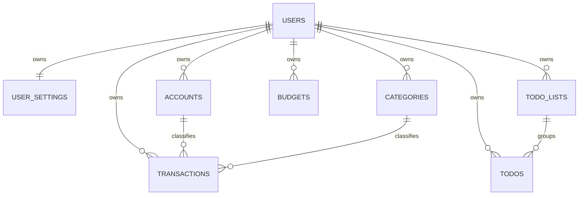

# 轻记 MVP 数据模型

> 状态：与 [`architecture.md`](./architecture.md) 和 [`api-design.md`](./api-design.md) 配套的规范模型。  
> 类型采用 CloudBase 文档型数据库语义；本文中的 `Date` 在 API 层一律转换为 ISO 8601 字符串。

## 1. 全局约定

### 1.1 字段与数据归属

- `_id: String` 由数据库生成，API 中以对应业务名返回，如 `transactionId`、`todoId`。
- 除 `users` 和服务端共享的 `weather_cache` 外，所有用户业务集合必须包含 `ownerId: String`，指向 `users._id`。
- `ownerId`、`openId`、审计时间、`version` 和删除状态只能由云函数写入。
- 业务集合只允许云函数读写；客户端数据库权限规则默认拒绝。
- 引用字段（如 `accountId`、`categoryId`、`listId`）必须在写入时验证被引用记录属于相同 `ownerId`。

### 1.2 金额

- 金额均为以分为单位的 `Number` 安全整数，字段名带 `InCents`。
- 账单 `amountInCents > 0`；收支方向由 `type` 表示。
- MVP 币种固定为 `CNY`，不进行汇率换算。

### 1.3 时间

- 数据库具体时刻使用 `Date`；`createdAt`、`updatedAt` 等审计字段由云函数生成。
- 自然日使用 `YYYY-MM-DD` 字符串，月份使用 `YYYY-MM` 字符串，均按 `user_settings.timezone` 解释。
- 用户时区默认为 `Asia/Shanghai`。
- 软删除集合同时保存 `isDeleted: Boolean` 与 `deletedAt: Date | null`，正常查询必须包含 `isDeleted: false`。

### 1.4 并发与幂等

- 可更新资源保存 `version: Number`，初始为 1；更新/删除时按预期版本做条件更新。
- 创建账单、创建待办的 `requestId` 必填，并在所属用户范围内唯一。
- `requestId` 为调用方生成的 UUID，只用于幂等和排障，不作为业务主键。

## 2. 集合关系



`weather_cache` 是按位置共享的服务端缓存，不与用户形成归属关系；用户默认城市只在 `user_settings.defaultLocation` 中引用标准 `locationKey`。

## 3. `users`：用户身份

用途：将可信微信 `OPENID` 映射为内部用户 ID，并保存账号状态。仅云函数访问。

| 字段 | 类型 | 必填 | 规则 |
| --- | --- | --- | --- |
| `_id` | String | 是 | 内部用户 ID |
| `openId` | String | 是 | 来自 `getWXContext().OPENID`，唯一、不可返回前端 |
| `nickname` | String | 否 | 0–40 字，用户主动授权/填写后保存 |
| `avatarUrl` | String | 否 | 仅接受允许的 HTTPS 或云存储地址 |
| `status` | String | 是 | `active \| disabled \| deletion_pending \| deleted` |
| `createdAt` | Date | 是 | 服务端创建时间 |
| `updatedAt` | Date | 是 | 服务端更新时间 |
| `lastLoginAt` | Date | 是 | `user.init` 成功时更新 |
| `version` | Number | 是 | 初始 1 |

索引：

| 名称 | 字段（顺序） | 属性 | 用途 |
| --- | --- | --- | --- |
| `uq_users_open_id` | `openId` | 唯一 | 身份解析与初始化幂等 |
| `idx_users_status` | `status`, `updatedAt` | 普通 | 删除任务或运维检查 |

安全规则：前端禁止直接读写；API 不返回 `openId`。

## 4. `user_settings`：用户设置

用途：保存每个用户唯一的一份基础偏好，作为默认账户、位置和时区的唯一数据源。

| 字段 | 类型 | 必填 | 规则 |
| --- | --- | --- | --- |
| `_id` | String | 是 | 设置记录 ID |
| `ownerId` | String | 是 | `users._id`，唯一 |
| `currency` | String | 是 | MVP 固定 `CNY` |
| `timezone` | String | 是 | IANA 时区，默认 `Asia/Shanghai` |
| `defaultAccountId` | String \| null | 是 | 必须属于本人且已启用 |
| `defaultLocation` | Object \| null | 是 | 结构见下 |
| `showWeather` | Boolean | 是 | 默认 `true` |
| `showBudget` | Boolean | 是 | 仅启用基础预算功能时可为 `true` |
| `theme` | String | 是 | `system \| light \| dark` |
| `createdAt` | Date | 是 | 服务端生成 |
| `updatedAt` | Date | 是 | 服务端生成 |
| `version` | Number | 是 | 初始 1 |

`defaultLocation`：

```ts
interface DefaultLocation {
  locationKey: string;
  displayName: string;
  source: "manual" | "geolocation";
}
```

不保存位置轨迹；`locationKey` 是天气适配层认可的稳定标识，`displayName` 仅用于展示。

索引：

| 名称 | 字段 | 属性 |
| --- | --- | --- |
| `uq_user_settings_owner` | `ownerId` | 唯一 |

## 5. `accounts`：记账账户维度

用途：给账单提供账户分类。MVP 不维护真实余额。

| 字段 | 类型 | 必填 | 规则 |
| --- | --- | --- | --- |
| `_id` | String | 是 | 账户 ID |
| `ownerId` | String | 是 | 所属用户 |
| `name` | String | 是 | 去首尾空格后 1–30 字 |
| `type` | String | 是 | `cash \| wechat \| alipay \| bank \| other` |
| `icon` | String | 否 | 受控图标标识，不保存任意脚本/HTML |
| `sortOrder` | Number | 是 | 非负安全整数 |
| `isEnabled` | Boolean | 是 | 被历史账单引用时只停用不物理删除 |
| `createdAt` | Date | 是 | 服务端生成 |
| `updatedAt` | Date | 是 | 服务端生成 |
| `version` | Number | 是 | 初始 1 |

索引：

| 名称 | 字段（顺序） | 属性 | 用途 |
| --- | --- | --- | --- |
| `idx_accounts_owner_enabled_sort` | `ownerId`, `isEnabled`, `sortOrder` | 普通 | 账户列表 |

同名账户是否允许尚未确认，因此不设置名称唯一索引。默认账户的唯一事实源是 `user_settings.defaultAccountId`；账户列表中的“默认”状态在读取时派生，不在 `accounts` 重复存储。停用当前默认账户前必须在事务或等价的可恢复流程中先指定另一个有效账户。

## 6. `categories`：收支分类

用途：保存用户私有的系统默认分类副本和自定义分类。系统分类不采用 `ownerId = null` 的全局记录，从而保持统一归属规则。

| 字段 | 类型 | 必填 | 规则 |
| --- | --- | --- | --- |
| `_id` | String | 是 | 分类 ID |
| `ownerId` | String | 是 | 所属用户 |
| `type` | String | 是 | `expense \| income` |
| `name` | String | 是 | 去首尾空格后 1–20 字 |
| `icon` | String | 是 | 受控图标标识 |
| `sortOrder` | Number | 是 | 非负安全整数 |
| `isSystem` | Boolean | 是 | 初始化模板生成的分类为 `true` |
| `isEnabled` | Boolean | 是 | 已被账单引用时只停用 |
| `createdAt` | Date | 是 | 服务端生成 |
| `updatedAt` | Date | 是 | 服务端生成 |
| `version` | Number | 是 | 初始 1 |

索引：

| 名称 | 字段（顺序） | 属性 | 用途 |
| --- | --- | --- | --- |
| `idx_categories_owner_type_enabled_sort` | `ownerId`, `type`, `isEnabled`, `sortOrder` | 普通 | 分类选择列表 |

分类名先由业务校验在同一用户、同一类型内避免重复；是否建立唯一索引要等产品确认大小写和空格归一化规则。

## 7. `transactions`：账单

用途：保存收入与支出事实。MVP 不支持 `transfer`。

| 字段 | 类型 | 必填 | 规则 |
| --- | --- | --- | --- |
| `_id` | String | 是 | 账单 ID |
| `ownerId` | String | 是 | 所属用户 |
| `type` | String | 是 | `expense \| income` |
| `amountInCents` | Number | 是 | 正的安全整数，单位分 |
| `categoryId` | String | 是 | 本人、启用且类型匹配的分类 |
| `accountId` | String | 是 | 本人且启用的账户 |
| `occurredAt` | Date | 是 | 业务发生的具体时刻 |
| `occurredDateKey` | String | 是 | 服务端按用户时区派生的 `YYYY-MM-DD` |
| `merchant` | String \| null | 是 | 最长值待确认，空值统一为 `null` |
| `note` | String \| null | 是 | 最长值待确认，空值统一为 `null` |
| `includeInBudget` | Boolean | 是 | 仅支出影响预算，默认 `true` |
| `requestId` | String | 是 | 创建幂等键，所属用户范围内唯一 |
| `isDeleted` | Boolean | 是 | 默认 `false` |
| `deletedAt` | Date \| null | 是 | 删除时由服务端写入 |
| `createdAt` | Date | 是 | 服务端生成 |
| `updatedAt` | Date | 是 | 服务端生成 |
| `version` | Number | 是 | 初始 1 |

索引：

| 名称 | 字段（顺序） | 属性 | 用途 |
| --- | --- | --- | --- |
| `uq_transactions_owner_request` | `ownerId`, `requestId` | 唯一 | 创建幂等 |
| `idx_transactions_owner_active_time` | `ownerId`, `isDeleted`, `occurredAt`（降序） | 普通 | 默认流水、日期范围与游标分页 |
| `idx_transactions_owner_type_time` | `ownerId`, `isDeleted`, `type`, `occurredAt`（降序） | 普通 | 收支筛选与汇总 |
| `idx_transactions_owner_category_time` | `ownerId`, `isDeleted`, `categoryId`, `occurredAt`（降序） | 普通 | 分类筛选/统计 |
| `idx_transactions_owner_account_time` | `ownerId`, `isDeleted`, `accountId`, `occurredAt`（降序） | 普通 | 账户筛选 |

所有统计排除 `isDeleted = true`。列表使用 `(occurredAt, _id)` 稳定游标，避免 offset 深分页。

## 8. `budgets`：基础月预算

用途：保存每月总支出预算。MVP 不做分类预算和自动延续。

| 字段 | 类型 | 必填 | 规则 |
| --- | --- | --- | --- |
| `_id` | String | 是 | 预算 ID |
| `ownerId` | String | 是 | 所属用户 |
| `monthKey` | String | 是 | `YYYY-MM` |
| `budgetAmountInCents` | Number | 是 | 正的安全整数，单位分 |
| `createdAt` | Date | 是 | 服务端生成 |
| `updatedAt` | Date | 是 | 服务端生成 |
| `version` | Number | 是 | 初始 1 |

索引：

| 名称 | 字段（顺序） | 属性 |
| --- | --- | --- |
| `uq_budgets_owner_month` | `ownerId`, `monthKey` | 唯一 |

`spentInCents`、`remainingInCents` 和比例是查询时从有效支出账单计算的派生值，不落库作为事实字段。

## 9. `todo_lists`：待办清单

用途：提供默认清单和简单分组。MVP 至少创建一个不可删除的默认清单；复杂清单管理可后续实现。

| 字段 | 类型 | 必填 | 规则 |
| --- | --- | --- | --- |
| `_id` | String | 是 | 清单 ID |
| `ownerId` | String | 是 | 所属用户 |
| `name` | String | 是 | 1–30 字 |
| `icon` | String | 否 | 受控图标标识 |
| `sortOrder` | Number | 是 | 非负安全整数 |
| `isDefault` | Boolean | 是 | 每个用户一个默认清单 |
| `isEnabled` | Boolean | 是 | 默认清单不可停用 |
| `createdAt` | Date | 是 | 服务端生成 |
| `updatedAt` | Date | 是 | 服务端生成 |
| `version` | Number | 是 | 初始 1 |

索引：

| 名称 | 字段（顺序） | 属性 |
| --- | --- | --- |
| `idx_todo_lists_owner_enabled_sort` | `ownerId`, `isEnabled`, `sortOrder` | 普通 |

## 10. `todos`：待办

| 字段 | 类型 | 必填 | 规则 |
| --- | --- | --- | --- |
| `_id` | String | 是 | 待办 ID |
| `ownerId` | String | 是 | 所属用户 |
| `title` | String | 是 | 去首尾空格后 1–100 字 |
| `description` | String \| null | 是 | 空值统一为 `null`，最大长度待确认 |
| `status` | String | 是 | `pending \| doing \| completed \| cancelled` |
| `priority` | String | 是 | `high \| medium \| low \| none` |
| `listId` | String | 是 | 本人的有效待办清单 |
| `dueKind` | String | 是 | `none \| date \| datetime` |
| `dueDateKey` | String \| null | 是 | `YYYY-MM-DD`；`none` 时为 `null` |
| `dueAt` | Date \| null | 是 | 仅 `datetime` 使用 |
| `completedAt` | Date \| null | 是 | 进入 `completed` 时写入，撤销时清空 |
| `requestId` | String | 是 | 创建幂等键 |
| `isDeleted` | Boolean | 是 | 默认 `false` |
| `deletedAt` | Date \| null | 是 | 删除时写入 |
| `createdAt` | Date | 是 | 服务端生成 |
| `updatedAt` | Date | 是 | 服务端生成 |
| `version` | Number | 是 | 初始 1 |

字段组合约束：

| `dueKind` | `dueDateKey` | `dueAt` |
| --- | --- | --- |
| `none` | `null` | `null` |
| `date` | 必填 | `null` |
| `datetime` | 服务端派生 | 必填 |

索引：

| 名称 | 字段（顺序） | 属性 | 用途 |
| --- | --- | --- | --- |
| `uq_todos_owner_request` | `ownerId`, `requestId` | 唯一 | 创建幂等 |
| `idx_todos_owner_status_date` | `ownerId`, `isDeleted`, `status`, `dueDateKey` | 普通 | 今日、近期、已完成筛选 |
| `idx_todos_owner_list_status_date` | `ownerId`, `isDeleted`, `listId`, `status`, `dueDateKey` | 普通 | 清单筛选 |
| `idx_todos_owner_due_at` | `ownerId`, `isDeleted`, `dueAt` | 普通 | 精确时间排序和逾期判断 |
| `idx_todos_owner_created` | `ownerId`, `isDeleted`, `createdAt`（降序） | 普通 | 无截止时间与全部列表 |

MVP 不包含 `reminderAt`、`repeatRule`、`tags`、`isOutdoor`；这些字段在对应功能进入开发前另行设计，避免空字段被误认为已支持。

## 11. `weather_cache`：天气共享缓存

用途：缓存已经标准化的数据，降低供应商调用量。仅云函数访问，不属于用户业务数据。

| 字段 | 类型 | 必填 | 规则 |
| --- | --- | --- | --- |
| `_id` | String | 是 | 缓存记录 ID |
| `cacheKey` | String | 是 | `${provider}:${locationKey}:${dataType}`，唯一 |
| `provider` | String | 是 | 受控供应商标识 |
| `locationKey` | String | 是 | 标准位置标识，不存储轨迹 |
| `displayName` | String | 是 | 标准展示名 |
| `dataType` | String | 是 | `current \| daily \| location_search` |
| `normalizedData` | Object | 是 | 只保存标准化 DTO，结构版本化 |
| `schemaVersion` | Number | 是 | 当前从 1 开始 |
| `observedAt` | Date | 是 | 气象数据对应时刻 |
| `fetchedAt` | Date | 是 | 最近成功拉取时间 |
| `expiresAt` | Date | 是 | 新鲜缓存失效时间 |
| `staleUntil` | Date | 是 | 供应商失败时允许降级的最晚时间 |
| `updatedAt` | Date | 是 | 服务端生成 |

索引：

| 名称 | 字段（顺序） | 属性 | 用途 |
| --- | --- | --- | --- |
| `uq_weather_cache_key` | `cacheKey` | 唯一 | 缓存读取与覆盖 |
| `idx_weather_cache_expiry` | `expiresAt` | 普通 | 过期缓存运维 |
| `idx_weather_cache_stale_until` | `staleUntil` | 普通 | 物理清理候选 |

不要直接缓存供应商原始响应，以免字段漂移、敏感字段或无用数据进入数据库。

## 12. 数据初始化与删除

### 12.1 用户初始化

`user.init` 必须可幂等执行：

1. 按可信 `openId` 获取或创建 `users`；
2. 创建唯一 `user_settings`；
3. 创建默认账户，并将其 ID 写入设置；
4. 按收入/支出模板复制一组该用户私有分类；
5. 创建默认待办清单；
6. 更新 `lastLoginAt`，返回安全用户摘要和设置。

并发首次调用需依赖 `openId` 唯一索引处理重复创建，失败后可安全重试并补齐缺失默认数据。

### 12.2 用户删除

具体冷静期和保留策略待产品/合规确认。无论采取立即删除还是延迟删除，删除作业都必须：

- 先将 `users.status` 置为 `deletion_pending` 并阻止普通业务写入；
- 按 `ownerId` 删除或匿名化 `user_settings`、账户、分类、账单、预算、待办清单和待办；
- 清理属于用户的云存储对象（若未来启用附件）；
- 不删除共享 `weather_cache`，因为其中不得包含用户身份或轨迹；
- 保存最小化、脱敏且符合法定期限的删除审计结果。

## 13. 数据模型待定项

1. 单笔金额、预算金额、备注、描述和商户字段的确切长度上限；
2. 同类型分类名和账户名是否区分大小写、是否允许重复；
3. 基础预算是否进入首发 MVP；
4. 个人数据删除冷静期、软删除保留期和物理清理周期；
5. 默认分类和默认账户的最终产品文案与图标集合；
6. 天气供应商确定后，`locationKey` 格式和 `normalizedData` 的最终字段映射；
7. CloudBase 控制台对目标组合索引方向与数量限制的最终部署验证。
