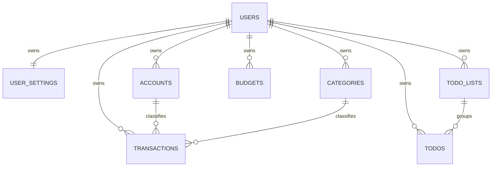

# 轻记 MVP 数据模型

> 状态：与 [`architecture.md`](./architecture.md) 和 [`api-design.md`](./api-design.md) 配套的规范模型。  
> 类型采用 CloudBase 文档型数据库语义；本文中的 `Date` 在 API 层一律转换为 ISO 8601 字符串。

## 1. 全局约定

### 1.1 字段与数据归属

- `_id: String` 由数据库生成，API 中以对应业务名返回，如 `transactionId`、`todoId`。
- 除 `users` 和服务端共享的 `weather_cache` 外，所有用户业务集合必须包含 `ownerId: String`，指向 `users._id`。
- `ownerId`、`openId`、审计时间、`version` 和删除状态只能由云函数写入。
- 业务集合只允许云函数读写；客户端数据库权限规则默认拒绝。
- 引用字段（如 `accountId`、`categoryId`、`listId`）必须在写入时验证被引用记录属于相同 `ownerId`。
- `categories` 和 `accounts` 的 `systemKey` 是不可由用户修改的稳定键；系统默认项使用固定模板键，自定义项使用创建请求生成的唯一键，不能依赖可修改名称判断默认项。

### 1.2 金额

- 金额均为以分为单位的 `Number` 安全整数，字段名带 `InCents`。
- 账单 `amountInCents > 0`；收支方向由 `type` 表示。
- MVP 币种固定为 `CNY`，不进行汇率换算。

### 1.3 时间

- 数据库具体时刻使用 `Date`；`createdAt`、`updatedAt` 等审计字段由云函数生成。
- 自然日使用 `YYYY-MM-DD` 字符串，月份使用 `YYYY-MM` 字符串，均按 `user_settings.timezone` 解释。
- 用户时区默认为 `Asia/Shanghai`。
- 软删除集合同时保存 `isDeleted: Boolean` 与 `deletedAt: Date | null`，正常查询必须包含 `isDeleted: false`。

### 1.4 并发与幂等

- 可更新资源保存 `version: Number`，初始为 1；更新/删除时按预期版本做条件更新。
- 创建账单、创建待办的 `requestId` 必填，并在所属用户范围内唯一。
- `requestId` 为调用方生成的 UUID，只用于幂等和排障，不作为业务主键。

## 2. 集合关系



`weather_cache` 是按位置共享的服务端缓存，不与用户形成归属关系；用户默认城市只在 `user_settings.defaultLocation` 中引用标准 `locationKey`。

## 3. `users`：用户身份

用途：将可信微信 `OPENID` 映射为内部用户 ID，并保存账号状态。仅云函数访问。

| 字段 | 类型 | 必填 | 规则 |
| --- | --- | --- | --- |
| `_id` | String | 是 | 内部用户 ID |
| `openId` | String | 是 | 来自 `getWXContext().OPENID`，唯一、不可返回前端 |
| `nickname` | String \| null | 是 | 默认 `null`；0–40 字，用户主动授权/填写后保存 |
| `avatarUrl` | String \| null | 是 | 默认 `null`；仅接受允许的 HTTPS 或云存储地址 |
| `status` | String | 是 | `active \| disabled \| deletion_pending \| deleted` |
| `createdAt` | Date | 是 | 服务端创建时间 |
| `updatedAt` | Date | 是 | 服务端更新时间 |
| `lastLoginAt` | Date | 是 | `user.init` 成功时更新 |
| `version` | Number | 是 | 初始 1 |

索引：

| 名称 | 字段（顺序） | 属性 | 用途 |
| --- | --- | --- | --- |
| `uq_users_open_id` | `openId` | 唯一 | 身份解析与初始化幂等 |
| `idx_users_status` | `status`, `updatedAt` | 普通 | 删除任务或运维检查 |

安全规则：前端禁止直接读写；API 不返回 `openId`。

## 4. `user_settings`：用户设置

用途：保存每个用户唯一的一份基础偏好，作为记账默认值、位置和时区的唯一数据源。

| 字段 | 类型 | 必填 | 规则 |
| --- | --- | --- | --- |
| `_id` | String | 是 | 设置记录 ID |
| `ownerId` | String | 是 | `users._id`，唯一 |
| `currency` | String | 是 | MVP 固定 `CNY` |
| `timezone` | String | 是 | IANA 时区，默认 `Asia/Shanghai` |
| `defaultTransactionType` | String | 是 | `expense \| income`，默认 `expense` |
| `defaultExpenseAccountId` | String | 是 | 默认支付方式；必须属于本人且已启用 |
| `defaultIncomeAccountId` | String | 是 | 默认收款方式；必须属于本人且已启用 |
| `defaultLocation` | Object \| null | 是 | 结构见下 |
| `preferGeolocation` | Boolean | 是 | 默认 `false`；不绕过用户主动授权 |
| `showWeather` | Boolean | 是 | 默认 `true` |
| `showBudget` | Boolean | 是 | 仅启用基础预算功能时可为 `true` |
| `theme` | String | 是 | `system \| light \| dark` |
| `initializationVersion` | Number | 是 | 当前为 `2`；旧单默认渠道在初始化时迁移为收、付款两个默认值 |
| `createdAt` | Date | 是 | 服务端生成 |
| `updatedAt` | Date | 是 | 服务端生成 |
| `version` | Number | 是 | 初始 1 |

`defaultLocation`：

```ts
interface DefaultLocation {
  locationKey: string;
  displayName: string;
  source: "manual" | "geolocation";
}
```

不保存位置轨迹；`locationKey` 是天气适配层认可的稳定标识，`displayName` 仅用于展示。

索引：

| 名称 | 字段 | 属性 |
| --- | --- | --- |
| `uq_user_settings_owner` | `ownerId` | 唯一 |

## 5. `accounts`：固定资金渠道维度

用途：给账单提供固定的支付/收款方式。内部集合名为 `accounts`，但它不表示资产，不保存资产数值，也不提供用户自定义管理。

| 字段 | 类型 | 必填 | 规则 |
| --- | --- | --- | --- |
| `_id` | String | 是 | 账户 ID |
| `ownerId` | String | 是 | 所属用户 |
| `systemKey` | String | 是 | 系统项如 `account_wechat`；自定义项使用唯一生成键，不可修改 |
| `name` | String | 是 | 去首尾空格后 1–30 字 |
| `type` | String | 是 | `cash \| wechat \| alipay \| bank \| other` |
| `icon` | String | 否 | 受控图标标识，不保存任意脚本/HTML |
| `sortOrder` | Number | 是 | 非负安全整数 |
| `isSystem` | Boolean | 是 | 初始化模板生成的账户为 `true` |
| `isEnabled` | Boolean | 是 | 被历史账单引用时只停用不物理删除 |
| `createdAt` | Date | 是 | 服务端生成 |
| `updatedAt` | Date | 是 | 服务端生成 |
| `version` | Number | 是 | 初始 1 |

索引：

| 名称 | 字段（顺序） | 属性 | 用途 |
| --- | --- | --- | --- |
| `idx_accounts_owner_enabled_sort` | `ownerId`, `isEnabled`, `sortOrder` | 普通 | 固定渠道选择列表 |
| `uq_accounts_owner_system_key` | `ownerId`, `systemKey` | 唯一 | 固定渠道初始化与并发幂等 |

固定渠道名称、启用状态和顺序不开放用户修改，因此不设置名称唯一索引。默认支付和收款方式的唯一事实源分别是 `user_settings.defaultExpenseAccountId` 与 `defaultIncomeAccountId`；列表中的“默认”状态按查询的收支类型派生，不在 `accounts` 重复存储。

## 6. `categories`：收支分类

用途：保存用户私有的系统默认分类副本和自定义分类。系统分类不采用 `ownerId = null` 的全局记录，从而保持统一归属规则。

| 字段 | 类型 | 必填 | 规则 |
| --- | --- | --- | --- |
| `_id` | String | 是 | 分类 ID |
| `ownerId` | String | 是 | 所属用户 |
| `type` | String | 是 | 只允许 `expense \| income` |
| `systemKey` | String | 是 | 如 `expense_food`、`income_salary`；自定义项使用唯一生成键，不可修改 |
| `name` | String | 是 | 去首尾空格后 1–20 字 |
| `icon` | String | 是 | 受控图标标识 |
| `sortOrder` | Number | 是 | 非负安全整数 |
| `isSystem` | Boolean | 是 | 初始化模板生成的分类为 `true` |
| `isEnabled` | Boolean | 是 | 已被账单引用时只停用 |
| `createdAt` | Date | 是 | 服务端生成 |
| `updatedAt` | Date | 是 | 服务端生成 |
| `version` | Number | 是 | 初始 1 |

索引：

| 名称 | 字段（顺序） | 属性 | 用途 |
| --- | --- | --- | --- |
| `idx_categories_owner_type_enabled_sort` | `ownerId`, `type`, `isEnabled`, `sortOrder` | 普通 | 分类选择列表 |
| `uq_categories_owner_type_system_key` | `ownerId`, `type`, `systemKey` | 唯一 | 默认分类初始化与并发幂等 |

分类名先由业务校验在同一用户、同一类型内避免重复；是否建立唯一索引要等产品确认大小写和空格归一化规则。

## 7. `transactions`：账单

用途：保存收入与支出事实。

| 字段 | 类型 | 必填 | 规则 |
| --- | --- | --- | --- |
| `_id` | String | 是 | 账单 ID |
| `ownerId` | String | 是 | 所属用户 |
| `type` | String | 是 | `expense \| income` |
| `amountInCents` | Number | 是 | 正的安全整数，单位分；单笔不超过 `9,999,999,999` 分 |
| `categoryId` | String | 是 | 本人、启用且类型匹配的分类 |
| `accountId` | String | 是 | 本人且启用的账户 |
| `occurredAt` | Date | 是 | 业务发生的具体时刻 |
| `occurredDateKey` | String | 是 | 服务端按用户时区派生的 `YYYY-MM-DD` |
| `merchant` | String \| null | 是 | 当前新增支出固定为 `null`，后续商家功能另行开放 |
| `note` | String \| null | 是 | 去首尾空格，最长 200 字；空值统一为 `null` |
| `tags` | String[] | 是 | 当前固定为空数组，不开放标签写入 |
| `attachmentUrls` | String[] | 是 | 当前固定为空数组，不开放凭证上传 |
| `includeInBudget` | Boolean | 是 | 仅支出影响预算；支出固定 `true`，收入固定 `false` |
| `requestId` | String | 是 | 创建幂等键，所属用户范围内唯一 |
| `isDeleted` | Boolean | 是 | 默认 `false` |
| `deletedAt` | Date \| null | 是 | 删除时由服务端写入 |
| `lastMutationRequestId` | String | 否 | 最近一次成功编辑或删除的 UUID，用于单账单幂等重试 |
| `lastMutationKind` | String | 否 | `update \| delete` |
| `lastMutationFingerprint` | String | 否 | 服务端对规范化变更请求计算的 SHA-256，不保存明文备注副本 |
| `lastMutationPreviousOccurredAt` | Date | 否 | 最近变更前发生时间，用于重试响应和跨月刷新 |
| `createdAt` | Date | 是 | 服务端生成 |
| `updatedAt` | Date | 是 | 服务端生成 |
| `version` | Number | 是 | 初始 1 |

索引：

| 名称 | 字段（顺序） | 属性 | 用途 |
| --- | --- | --- | --- |
| `uq_transactions_owner_request` | `ownerId`, `requestId` | 唯一 | 创建幂等 |
| `idx_transactions_owner_type_active_occurred_id` | `ownerId`（升序）, `type`（升序）, `isDeleted`（升序）, `occurredAt`（降序）, `_id`（降序） | 普通 | 指定月份收支流水、稳定游标分页与月度汇总 |
| `idx_transactions_owner_active_occurred_id` | `ownerId`（升序）, `isDeleted`（升序）, `occurredAt`（降序）, `_id`（降序） | 普通 | 默认混合收支流水的全局稳定排序与游标分页 |
| `idx_transactions_owner_category_time` | `ownerId`, `isDeleted`, `categoryId`, `occurredAt`（降序） | 普通 | 分类筛选/统计 |
| `idx_transactions_owner_type_category_active_occurred_id` | `ownerId`, `type`, `isDeleted`, `categoryId`, `occurredAt`（降序）, `_id`（降序） | 普通 | 统计分类下钻后的稳定分页 |
| `idx_transactions_owner_account_time` | `ownerId`, `isDeleted`, `accountId`, `occurredAt`（降序） | 普通 | 账户筛选 |

所有统计排除 `isDeleted = true`。当前流水页面默认单次查询 `type in [expense, income]`，也允许明确筛选单一类型；始终固定 `isDeleted = false`，按用户当前 `user_settings.timezone` 计算 `monthStart <= occurredAt < nextMonthStart`，使用 `(occurredAt DESC, _id DESC)` 全局稳定游标，避免双查询合并和 offset 深分页。列表 DTO 的 `occurredDateKey` 也按查询时的当前时区重新派生，因此修改时区后不会依赖写入时的旧日期键。

收入和支出编辑、删除均按 `_id` 在 CloudBase 事务内读取，再校验可信 `ownerId`、记录原类型、`isDeleted` 和 `version`。创建和编辑时校验 `accountId` 指向本人的启用资金渠道；交易不会修改渠道文档。API 的 `status=active/deleted` 由 `isDeleted` 派生，避免保存两套可能冲突的状态事实。

`uq_transactions_owner_request`、`idx_transactions_owner_type_active_occurred_id` 与 `idx_transactions_owner_active_occurred_id` 都是当前收支闭环的部署必需索引，需在每个 CloudBase 环境的控制台手工创建；代码不会自动创建索引。带 `type` 的旧索引继续服务单类型筛选和按类型月度聚合，新索引服务混合结果的全局时间排序，两者用途不同，不是重复索引。分类和账户展示采用按本页引用 ID 批量关联当前记录的方案，不保存名称快照：分类或账户改名会同步反映到历史流水；关联记录意外缺失时只显示“未知分类/未知账户”，不会暴露其他用户记录。交易 `_id` 同时由 `ownerId + requestId` 确定性生成，并在服务端事务中先读后写；唯一索引仍是上线必需的数据完整性防线。

## 8. `budgets`：基础月预算

用途：保存每月总支出预算。MVP 不做分类预算和自动延续。

| 字段 | 类型 | 必填 | 规则 |
| --- | --- | --- | --- |
| `_id` | String | 是 | 预算 ID |
| `ownerId` | String | 是 | 所属用户 |
| `monthKey` | String | 是 | `YYYY-MM` |
| `budgetAmountInCents` | Number | 是 | 正的安全整数，单位分 |
| `createdAt` | Date | 是 | 服务端生成 |
| `updatedAt` | Date | 是 | 服务端生成 |
| `version` | Number | 是 | 初始 1 |

索引：

| 名称 | 字段（顺序） | 属性 |
| --- | --- | --- |
| `uq_budgets_owner_month` | `ownerId`, `monthKey` | 唯一 |

`spentInCents`、`remainingInCents` 和比例是查询时从有效支出账单计算的派生值，不落库作为事实字段。

## 9. `todo_lists`：待办清单

用途：提供默认清单和简单分组。MVP 至少创建一个不可删除的默认清单；复杂清单管理可后续实现。

| 字段 | 类型 | 必填 | 规则 |
| --- | --- | --- | --- |
| `_id` | String | 是 | 清单 ID |
| `ownerId` | String | 是 | 所属用户 |
| `name` | String | 是 | 1–30 字 |
| `icon` | String | 否 | 受控图标标识 |
| `sortOrder` | Number | 是 | 非负安全整数 |
| `isDefault` | Boolean | 是 | 每个用户一个默认清单 |
| `isEnabled` | Boolean | 是 | 默认清单不可停用 |
| `createdAt` | Date | 是 | 服务端生成 |
| `updatedAt` | Date | 是 | 服务端生成 |
| `version` | Number | 是 | 初始 1 |

索引：

| 名称 | 字段（顺序） | 属性 |
| --- | --- | --- |
| `idx_todo_lists_owner_enabled_sort` | `ownerId` 升序, `isEnabled` 升序, `sortOrder` 升序, `_id` 升序 | 普通 |

## 10. `todos`：待办

| 字段 | 类型 | 必填 | 规则 |
| --- | --- | --- | --- |
| `_id` | String | 是 | 待办 ID |
| `ownerId` | String | 是 | 所属用户 |
| `title` | String | 是 | 去首尾空格后 1–100 字 |
| `description` | String \| null | 是 | 空值统一为 `null`，去首尾空格后最多 500 字 |
| `status` | String | 是 | `pending \| doing \| completed \| cancelled` |
| `priority` | String | 是 | `high \| medium \| low \| none` |
| `listId` | String | 是 | 本人的有效待办清单 |
| `dueKind` | String | 是 | `none \| date \| datetime` |
| `dueDateKey` | String \| null | 是 | `YYYY-MM-DD`；`none` 时为 `null` |
| `dueAt` | Date \| null | 是 | 仅 `datetime` 使用 |
| `completedAt` | Date \| null | 是 | 进入 `completed` 时写入，撤销时清空 |
| `requestId` | String | 是 | 创建幂等键 |
| `createFingerprint` | String | 是 | 服务端对规范化创建参数计算的 SHA-256；不返回前端 |
| `isDeleted` | Boolean | 是 | 默认 `false` |
| `deletedAt` | Date \| null | 是 | 删除时写入 |
| `createdAt` | Date | 是 | 服务端生成 |
| `updatedAt` | Date | 是 | 服务端生成 |
| `version` | Number | 是 | 初始 1 |
| `lastMutationRequestId` | String | 否 | 最近一次编辑、状态或删除请求的幂等键；不返回前端 |
| `lastMutationFingerprint` | String | 否 | 最近一次修改参数摘要；不返回前端 |

字段组合约束：

| `dueKind` | `dueDateKey` | `dueAt` |
| --- | --- | --- |
| `none` | `null` | `null` |
| `date` | 必填 | `null` |
| `datetime` | 服务端派生 | 必填 |

索引：

| 名称 | 字段（顺序） | 属性 | 用途 |
| --- | --- | --- | --- |
| `uq_todos_owner_request` | `ownerId`, `requestId` | 唯一 | 创建幂等 |
| `idx_todos_owner_active_created_id` | `ownerId` 升序, `isDeleted` 升序, `createdAt` 降序, `_id` 降序 | 普通 | 全部列表和复合游标 |
| `idx_todos_owner_active_date_created_id` | `ownerId` 升序, `isDeleted` 升序, `dueDateKey` 升序, `createdAt` 降序, `_id` 降序 | 普通 | 今日视图 |
| `idx_todos_owner_active_status_date_created_id_v2` | `ownerId` 升序, `isDeleted` 升序, `status` 升序, `dueDateKey` 升序, `createdAt` 降序, `_id` 降序 | 普通 | 近期视图；开发环境以该精确方向索引为准 |
| `idx_todos_owner_active_status_created_id` | `ownerId` 升序, `isDeleted` 升序, `status` 升序, `createdAt` 降序, `_id` 降序 | 普通 | 已完成视图 |
| `idx_todos_owner_active_status_kind_date_created_id` | `ownerId` 升序, `isDeleted` 升序, `status` 升序, `dueKind` 升序, `dueDateKey` 升序, `createdAt` 降序, `_id` 降序 | 普通 | 日期型逾期分支 |
| `idx_todos_owner_active_status_kind_at_created_id` | `ownerId` 升序, `isDeleted` 升序, `status` 升序, `dueKind` 升序, `dueAt` 升序, `createdAt` 降序, `_id` 降序 | 普通 | 时间型逾期分支 |

MVP 不包含 `reminderAt`、`repeatRule`、`tags`、`isOutdoor`；这些字段在对应功能进入开发前另行设计，避免空字段被误认为已支持。

## 11. `weather_cache`：天气共享缓存

用途：缓存已经标准化的数据，降低供应商调用量。仅云函数访问，不属于用户业务数据。

| 字段 | 类型 | 必填 | 规则 |
| --- | --- | --- | --- |
| `_id` | String | 是 | 缓存记录 ID |
| `cacheKey` | String | 是 | `${provider}:${locationKey}:${dataType}`，唯一 |
| `provider` | String | 是 | 受控供应商标识 |
| `locationKey` | String | 是 | 标准位置标识，不存储轨迹 |
| `displayName` | String | 是 | 标准展示名 |
| `dataType` | String | 是 | `current \| daily \| location_search` |
| `normalizedData` | Object | 是 | 只保存标准化 DTO，结构版本化 |
| `schemaVersion` | Number | 是 | 当前从 1 开始 |
| `observedAt` | Date | 是 | 气象数据对应时刻 |
| `fetchedAt` | Date | 是 | 最近成功拉取时间 |
| `expiresAt` | Date | 是 | 新鲜缓存失效时间 |
| `staleUntil` | Date | 是 | 供应商失败时允许降级的最晚时间 |
| `updatedAt` | Date | 是 | 服务端生成 |

索引：

| 名称 | 字段（顺序） | 属性 | 用途 |
| --- | --- | --- | --- |
| `uq_weather_cache_key` | `cacheKey` | 唯一 | 缓存读取与覆盖 |
| `idx_weather_cache_expiry` | `expiresAt` | 普通 | 过期缓存运维 |
| `idx_weather_cache_stale_until` | `staleUntil` | 普通 | 物理清理候选 |

不要直接缓存供应商原始响应，以免字段漂移、敏感字段或无用数据进入数据库。

当前 Open-Meteo adapter 使用 `locationKey = open-meteo:<latitude>,<longitude>`，坐标最多四位小数。`current` 的 `normalizedData` 保存标准化 `location` 与 `current`，`daily` 保存最多三天的标准化 `daily`；两类记录分别计算过期时间和陈旧窗口。当前天气没有对应降水概率时该字段为 `null`，逐日预报保存供应商返回的最大降水概率。历史 `qweather:` 默认城市不再兼容，升级后需清空并由用户重新选择；旧缓存可等待自然过期，无需破坏性删除。

## 12. `data_deletion_requests`：个人数据删除申请

用途：保存当前用户唯一的删除申请、7 天冷静期、后台批次进度和最小化审计状态。该集合仅云函数可访问，使用按 `ownerId` 派生的确定性 `_id`，因此同一用户最多存在一条当前申请记录。

| 字段 | 类型 | 必填 | 规则 |
| --- | --- | --- | --- |
| `_id` | String | 是 | 按可信 `ownerId` 派生 |
| `ownerId` | String | 是 | `users._id` |
| `requestId` | String | 是 | 前端生成 UUID；同一次申请重试复用 |
| `status` | String | 是 | `pending \| cancelled \| processing \| completed \| failed` |
| `requestedAt` | Date | 是 | 服务端时间 |
| `cooldownEndsAt` | Date | 是 | `requestedAt + 7 天` |
| `cancelledAt` / `processingStartedAt` / `completedAt` / `failedAt` | Date \| null | 是 | 服务端状态时间 |
| `nextRetryAt` / `leaseExpiresAt` | Date \| null | 是 | 失败恢复与执行租约 |
| `attempts` | Number | 是 | 后台认领次数 |
| `progress` | Object | 是 | 当前集合序号和各集合已删除数量 |
| `lastErrorCode` | String \| null | 是 | 受控错误码，不保存堆栈 |
| `createdAt` / `updatedAt` | Date | 是 | 服务端时间 |
| `version` | Number | 是 | 乐观并发版本 |

索引：`idx_data_deletion_runnable(status, cooldownEndsAt)`、`idx_data_deletion_retry(status, nextRetryAt)` 和 `idx_data_deletion_lease(status, leaseExpiresAt)`。`ownerId` 由确定性文档 ID 保证唯一，仍可增加唯一索引 `uq_data_deletion_owner` 作为完整性防线。

## 13. 数据初始化与删除

### 13.1 用户初始化

`user.init` 必须可幂等执行：

1. 按可信 `openId` 获取或创建 `users`；
2. 按稳定 `systemKey` 补齐 11 个支出分类和 8 个收入分类；
3. 按稳定 `systemKey` 补齐 5 个默认固定渠道；
4. 创建唯一 `user_settings`，首次初始化将微信渠道同时写入默认支付方式和默认收款方式；
5. 更新 `lastLoginAt`，返回安全用户摘要、设置和本次实际创建数量。

初始化文档 ID 由可信身份和稳定键确定，全部写入在服务端事务内完成；唯一索引作为第二道并发保护。重复调用只补齐缺失项，不覆盖名称、启用状态或用户已经选择的默认支付/收款方式。默认待办清单由后续待办域任务实现，本次初始化不创建待办数据。

### 13.2 用户删除

个人数据删除申请统一采用 7 天冷静期：

- `dataDeletion.request` 使用顶层 `requestId` 幂等创建申请，并将 `users.status` 置为 `deletion_pending`；
- `pending` 可由 `dataDeletion.cancel` 撤销并恢复 `users.status = active`；
- 普通前端只能查询、申请和撤销，不能调用正式删除执行器；
- 独立执行器必须验证服务端环境令牌，只认领冷静期已结束、租约过期或到达重试时间的申请；
- 按 `ownerId` 分批删除实际存在的 `transactions`、`todos`、`todo_lists`、`categories`、`accounts` 和 `user_settings`，最后按 `_id` 删除 `users`；
- 每批保存集合序号和删除计数；重复执行、文档已不存在和失败重试均安全；
- 清理属于用户的云存储对象（若未来启用附件）；
- 不删除共享 `weather_cache`，因为其中不得包含用户身份或轨迹；
- 保留最小化的 `data_deletion_requests` 状态作为删除审计，不保存 `openId` 或业务正文。

## 14. 统计派生模型

统计分析不新增集合，也不把月度汇总、趋势或分类占比作为事实字段落库。所有结果都从当前用户 `isDeleted = false` 的收入/支出交易按 `user_settings.timezone` 计算：

- 月度概览分别聚合收入、支出金额与笔数，结余为整数分相减；
- 6/12 个月趋势逐月在云端聚合并补齐零值月份；
- 分类排行按 `categoryId` 聚合金额和笔数，再批量关联当前用户的分类文档；
- 分类文档缺失时使用“已删除分类”和 `other` 图标，不丢弃历史金额；
- 占比使用整数万分比 `ratioBasisPoints`，金额始终保持整数分。

当前不引入统计缓存集合。若真实数据量和 CloudBase 指标证明逐月聚合成为瓶颈，再单独设计可重建、带版本的汇总缓存。

## 15. 数据模型待定项

1. 预算金额、待办描述和未来商户字段的确切长度上限；支出单笔上限与备注长度本次已确定；
2. 同类型分类名是否区分大小写、是否允许重复；
3. 基础预算是否进入首发 MVP；
4. 删除申请审计记录和云函数日志的生产保留期限；
5. 默认分类和固定支付/收款渠道的最终产品文案与图标集合；
6. CloudBase 控制台对其余目标组合索引方向与数量限制的最终部署验证。
