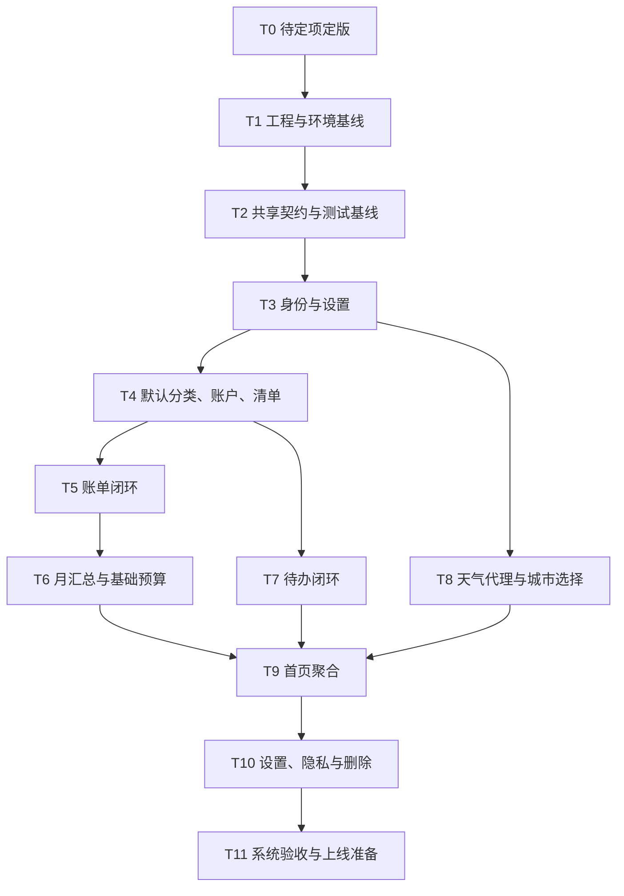

# 轻记 MVP 开发计划

> 目标：把 MVP 拆成可独立实施、验证和验收的小任务。  
> 本计划不授权扩大产品范围；每项任务开始前仍需读取根目录 `AGENTS.md`，结束后运行项目当时已有的类型检查、测试和构建命令。

## 1. 计划原则

- 每个任务只引入完成该任务所需的文件和依赖，不生成大量占位页面或空模块。
- 先建立安全边界和共享契约，再开发页面；页面始终通过 service 和云函数访问数据。
- 每项任务都必须具备明确输入、输出和验收证据，未确认的产品值先形成决策记录。
- 跨用户隔离、金额整数分、带时区时间和天气密钥云端保存是贯穿所有任务的阻断性验收项。
- OCR、AI、家庭账本、团队协作及 [`requirements.md`](./requirements.md) 中列为 V1.1/V2.0 的功能不进入本计划。

## 2. 依赖关系

T5、T7、T8 在共同依赖完成后可并行开发；每条分支必须独立通过权限和契约测试。

## 3. 可独立验收任务

### T0：确认阻塞性产品与平台决策

**目标**：把会改变代码或数据语义的待定项形成短决策记录。

**工作内容**：

- 选择天气供应商、套餐、城市标识、许可与署名方式；
- 确认 CloudBase 开发/测试/生产环境、Node.js 运行时和部署方式；
- 确认微信基础库最低版本、UI 组件方案和包体积预算；
- 确认单笔金额上限、字段长度、基础预算是否首发；
- 确认数据删除冷静期、软删除保留期和隐私披露。

**输出**：`docs/decisions/` 下的小型 ADR 或对现有设计文档的明确更新。

**独立验收**：所有待定项有负责人和结论；尚不能决定的项有默认关闭策略，不会被实现者静默决定。

### T1：建立工程与 CloudBase 环境基线

**目标**：创建可构建的微信原生 TypeScript 小程序和最小云函数工程，不实现业务页面。

**工作内容**：

- 创建 `miniprogram/`、`cloudfunctions/`、`shared/` 的最小实际目录；
- 配置 TypeScript strict、开发/测试/生产环境映射、微信开发者工具项目；
- 配置 typecheck、test、build 及必要 lint 脚本；
- 配置 `.gitignore`、密钥扫描规则和环境变量名称说明；
- 建立最小健康检查云函数调用，验证小程序到正确环境的链路。

**独立验收**：

- 空壳小程序能在开发者工具启动；
- typecheck、test、build 命令存在且通过；
- 小程序前端没有 `wx.cloud.database()`；
- 仓库和构建产物不含真实天气密钥或永久云凭据；
- 三套环境不会误连同一生产集合。

### T2：共享契约、金额/时间工具与错误基线

**目标**：把跨模块最容易冲突的规则先做成可测试契约。

**工作内容**：

- 定义 `ApiResponse`、错误码、分页、版本和 request ID 类型；
- 实现金额字符串与整数分的解析/格式化纯函数；
- 实现 ISO 时间、IANA 时区、`dateKey`、`monthKey` 和半开区间工具；
- 建立前端 service 调用封装与云函数入口中间层；
- 建立运行时输入校验方式；若需要新生产依赖，先单独说明和审批。

**独立验收**：

- 金额边界、非法小数、指数形式和安全整数测试通过；
- 月末、闰日、时区日界线、`dueKind` 组合测试通过；
- 云函数受控错误不会泄漏堆栈；
- 请求和响应时间均为 ISO 8601，金额字段均带 `InCents`。

### T3：微信身份与用户设置

**目标**：完成可信身份解析、幂等初始化和基础设置 API/service，不开发完整设置页面。

**工作内容**：

- 创建 `users`、`user_settings` 集合、索引和拒绝客户端直连规则；
- 实现 `user.init`、`user.getSettings`、`user.updateSettings`；
- 只从 `getWXContext().OPENID` 解析身份；
- 实现用户状态、设置版本冲突和日志脱敏；
- 提供一个最小调试入口或自动化集成测试验证调用。

**独立验收**：

- 相同微信用户重复初始化只产生一名用户和一份设置；
- 请求伪造 `ownerId/openId/userId` 被拒绝；
- 两名测试用户不能获取或修改对方设置；
- `openId` 不出现在 API 响应和普通日志中；
- 设置更新能检测 `VERSION_CONFLICT`。

### T4：默认分类、账户和待办清单

**目标**：完成初始化所需基础数据和管理 API，为账单/待办提供合法引用。

**工作内容**：

- 建立 `accounts`、`categories`、`todo_lists` 集合与索引；
- 初始化每用户私有默认账户、默认分类和默认待办清单；
- 实现账户和分类的 MVP actions，以及 `listTodoLists`；
- 实现引用归属与启用状态校验；
- 以 `user_settings.defaultAccountId` 作为默认账户唯一事实源，账户 DTO 的默认状态由此派生。

**独立验收**：

- 初始化可重试且不会重复创建模板数据；
- 系统默认分类也带当前用户 `ownerId`；
- 已被引用的分类/账户只能停用，不能导致历史记录失去显示信息；
- 不能引用、停用或修改他人的记录；
- 每个用户始终有一个有效默认账户和默认待办清单。

### T5：账单新增、流水、编辑与删除闭环

> 分阶段状态：收入和支出的新增、按类型月度流水（游标分页、全月收支汇总、按日分组）、编辑和逻辑删除均已完成本地实现与自动测试。支出编辑、删除已完成真实 CloudBase 验证；本次收入能力仍需重新部署 `ledger` 后做一次真实环境验收，用户已明确跳过该步骤。

**目标**：完成收入/支出的端到端最小闭环。

**工作内容**：

- 建立 `transactions` 集合、唯一幂等索引和查询索引；
- 实现账单 create/get/update/delete/list action 与 ledger service；
- 实现金额、分类类型、账户、发生时间和用户归属校验；
- 实现逻辑删除、版本并发控制和游标分页；
- 开发最小可用的账单输入与流水页面，复杂统计图表不在本任务。

**独立验收**：

- 用户能新增、查看、编辑和删除自己的收入/支出；
- 同一 `requestId` 重试不产生重复账单，换 payload 复用该 ID 被拒绝；
- 数据库金额均为正整数分，无浮点金额；
- 分类类型与账单类型不匹配时保存失败；
- 删除记录不再出现在列表或后续统计中；
- 跨用户 ID 的读改删均返回同类 `RESOURCE_NOT_FOUND`。

### T6：本月汇总与基础预算

> 分阶段状态：独立 `ledger.getMonthlySummary`、整数分收支/结余汇总和首页月度收支卡片已完成本地实现与自动测试；分类汇总和预算不在本次范围，仍待后续决策与实现。

**目标**：提供首页和记账模块所需的整数汇总；基础预算是否启用取决于 T0 决策。

**工作内容**：

- 实现 `ledger.getMonthlySummary`，按用户时区计算区间；
- 验证收入、支出、结余、分类汇总全程使用整数分；
- 若首发预算：创建 `budgets` 集合并实现 get/upsert/delete；
- 优化查询和索引，避免全历史扫描；先测量后决定是否需要汇总表。

**独立验收**：

- 跨月、月末、闰日和用户时区边界统计正确；
- 编辑/删除账单后结果实时一致；
- `usageBasisPoints` 是整数且无除零；
- 汇总只包含当前用户、未删除且符合类型的账单；
- 在验收数据量下查询耗时满足 T0 确定的目标。

### T7：待办新增、列表、状态与删除闭环

**目标**：完成今日、近期、全部、已完成和逾期待办的最小闭环。

**工作内容**：

- 建立 `todos` 集合、幂等和查询索引；
- 实现 create/get/update/setStatus/delete/list action 与 todo service；
- 实现 `dueKind` 判别联合、完成/撤销、逾期计算和版本控制；
- 开发最小可用的待办列表和编辑页面；提醒、重复和日历不在本任务。

**独立验收**：

- 新增、修改、完成、撤销和删除可用；
- `date` 截止不被转换成午夜，`datetime` 保留绝对时刻；
- 无截止时间任务不被标记为今日或逾期；
- 今日和未来 7 日视图在时区边界正确；
- 幂等、版本冲突和跨用户隔离测试通过。

### T8：天气代理、缓存与城市选择

**目标**：在不泄漏密钥的前提下提供当前天气和三日预报。

**工作内容**：

- 完成选定供应商 adapter 和标准 DTO 映射；
- 真实 Key 仅配置在各 CloudBase 环境变量；
- 建立 `weather_cache` 集合、索引、15 分钟/2 小时 TTL 和陈旧降级；
- 实现 `searchLocations`、`getWeather` 与 weather service；
- 支持手动城市；定位权限只在用户主动触发时请求；
- 开发首页可复用天气卡片或最小天气调试视图。

**独立验收**：

- 前端包、仓库、日志和响应中均无天气 Key；
- 高频同位置请求命中新鲜缓存，不重复调用供应商；
- 供应商失败时在允许窗口内返回 `stale` 并显示更新时间，窗口外明确失败；
- 用户拒绝位置权限仍可使用记账、待办和手动城市；
- 任意 host、非法坐标和超长城市查询被拒绝。

### T9：首页聚合与局部降级

> 分阶段状态：首页已接入月度收支摘要、loading/empty/error/retry 状态及收入/支出快捷入口；天气、今日待办、今日收支、首页快照和统一 `home.getOverview` 尚未实现。

**目标**：形成天气、今日待办和收支摘要的首页闭环。

**工作内容**：

- 实现 `home.getOverview` 和 home service；
- 并行取得当日/月收支、今日/逾期待办和天气；
- 实现模块级 `success/unavailable`；
- 支持带时间戳的最近首页快照先展示后刷新；
- 开发首页聚合页面和两个快捷新增入口。

**独立验收**：

- 首页数字与账单/待办列表一致；
- 天气超时不阻断账目和待办；任一业务模块失败都有局部提示；
- 本地快照明确更新时间，不能覆盖更新后的服务端事实；
- 首屏请求数、响应体和耗时满足 T0/T1 确定的性能目标；
- 首页页面未直接调用数据库或第三方服务。

### T10：基础设置、隐私与个人数据删除

**目标**：提供设置入口和经确认的个人数据删除流程。

**工作内容**：

- 完成默认账户、默认城市、显示开关、主题等基础设置页面；
- 接入用户协议、隐私政策和位置用途说明；
- 按 T0 决策实现删除申请、冷静期/立即删除和后台清理；
- 验证云存储与日志标识清理策略（即使 MVP 暂无附件，也需验证边界）。

**独立验收**：

- 设置修改与各业务模块一致生效；
- 位置拒绝、撤销与重新选择流程可用；
- 删除申请后按状态阻止写入，并按政策清理所有 `ownerId` 数据；
- 共享天气缓存不含身份或轨迹，不随用户删除误删；
- 隐私披露与实际收集、第三方天气处理一致。

### T11：系统验收与上线准备

**目标**：完成跨模块、跨用户、异常和审核前验证。

**工作内容**：

- 执行类型检查、单元、集成、构建和微信开发者工具测试；
- 用至少两名测试用户执行数据隔离矩阵；
- 测试弱网、重试、并发、时区、金额边界、供应商异常和缓存；
- 审核索引命中、云函数日志、限流、告警和生产配置；
- 检查密钥、隐私政策、权限声明、环境隔离和小程序审核材料。

**独立验收**：

- [`requirements.md`](./requirements.md) 第十二章中属于本 MVP 的验收项均有证据；
- 四份技术文档和实现字段/API 无漂移；
- 无 P0/P1 缺陷，无跨用户读取/修改路径，无前端密钥；
- 类型检查、测试、构建和目标设备手测全部通过；
- 有发布、回滚、密钥轮换和数据备份/恢复说明。

## 4. 跨文档一致性检查

以下表格是实现和评审时的规范对照。若要修改其中任一项，必须同步更新 `architecture.md`、`data-model.md`、`api-design.md` 和相关测试。

| 概念 | 架构规范 | 数据库字段 | API 字段/语义 | 一致性结论 |
| --- | --- | --- | --- | --- |
| 所属用户 | 内部用户 ID | `ownerId` | 不接收、不返回 | 一致 |
| 微信身份 | `getWXContext().OPENID` | `users.openId` | 不接收、不返回 | 一致 |
| 账单金额 | 整数分 | `amountInCents` | `amountInCents` | 一致 |
| 基础预算 | 整数分 | `budgetAmountInCents` | `budgetAmountInCents` | 一致 |
| 收支方向 | 显式枚举 | `type: income \| expense` | 同名同枚举 | 一致 |
| 时区 | 设置唯一来源 | `user_settings.timezone` | `settings.timezone` | 一致 |
| 具体时刻 | DB `Date` | `*At: Date` | `*At: ISO 8601 string` | 一致（边界转换） |
| 自然日 | 用户时区 `YYYY-MM-DD` | `occurredDateKey`, `dueDateKey` | 同名 `DateKey` | 一致 |
| 月份 | 用户时区 `YYYY-MM` | `budgets.monthKey` | `monthKey` | 一致 |
| 待办截止语义 | `none/date/datetime` | `dueKind`, `dueDateKey`, `dueAt` | `DueInput` 判别联合 | 一致 |
| 软删除 | 查询显式排除 | `isDeleted`, `deletedAt` | 删除 DTO，不暴露内部标记 | 一致 |
| 并发控制 | 乐观版本 | `version` | `expectedVersion` / `version` | 一致 |
| 创建幂等 | 用户内 request ID 唯一 | `requestId` + 组合唯一索引 | 顶层 `requestId` | 一致 |
| 默认账户 | 设置是唯一事实源 | `user_settings.defaultAccountId` | `AccountDto.isDefault` 派生；`makeDefault` 更新设置 | 一致 |
| 默认位置 | 设置是唯一来源 | `user_settings.defaultLocation` | `DefaultLocationDto` | 一致 |
| 天气缓存状态 | fresh/refreshed/stale | 按时间字段推导 | `cacheStatus` | 一致 |
| 响应时间 | ISO 8601 | 不适用 | `serverTime` | 一致 |

### 4.1 已消除的需求稿冲突

- 将需求稿的用户业务字段 `userId` 统一为 `ownerId`；API 的当前用户摘要仍可返回只读 `userId`，但它不参与客户端授权。
- 将模糊的 `amount`、`totalAmount` 改为带单位的 `amountInCents`、`budgetAmountInCents`。
- 默认账户、默认城市和时区只存 `user_settings`，不再同时存 `users`。
- 系统分类改为按用户复制并带 `ownerId`，不再使用 `userId = null` 的共享记录。
- `timestamp` 响应字段改为 ISO 8601 `serverTime`，所有 API 时间边界一致。
- MVP 账单类型只有 `income/expense`；`transfer` 与余额维护延期。
- MVP 待办不保存重复、提醒、标签和户外联动占位字段。
- MVP 天气返回当前天气和三日预报；小时预报延期。

## 5. Definition of Done

任一开发任务只有同时满足下列条件才算完成：

- 只实现任务范围内的能力，没有夹带无关重构或未来功能；
- 页面未直接访问数据库，天气 Key 未进入前端或仓库；
- 所有用户数据查询和写入带 `ownerId`，跨用户负向测试通过；
- 金额、时间、错误、幂等和版本规则符合三份设计文档；
- 新增/修改接口有运行时校验、类型和测试；
- 项目现有 typecheck、test、build 及相关 lint 命令全部执行并通过；
- 微信 API 或样式改动在开发者工具及目标设备完成相称手测；
- 文档、实现与数据库索引同步，无未说明的生产依赖；
- 交付说明包含改动文件、验证结果、未验证项和风险。

## 6. 推荐下一项任务

建议从 **T0：确认阻塞性产品与平台决策** 开始，随后执行 **T1：建立工程与 CloudBase 环境基线**。当前最需要先确认的是天气供应商、三套 CloudBase 环境、运行时/UI 方案、金额上限和基础预算是否首发；这些决定会直接影响环境配置、隐私披露和首批接口测试数据。
